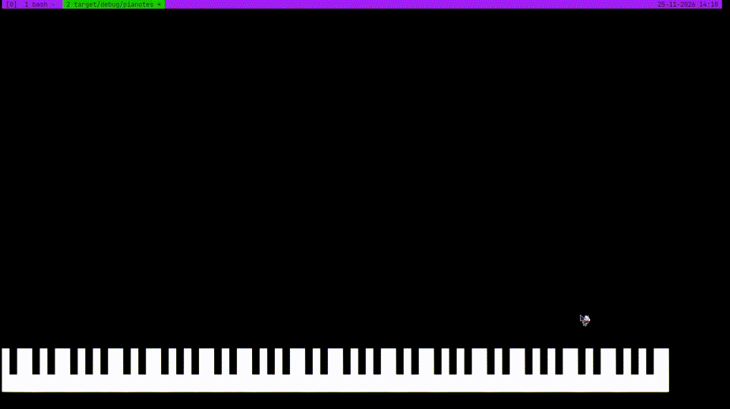

# pianotes

Piano visualizer that runs in the terminal. Written in `rust`.

> [!NOTE]
> This project is heavily inspired by [pianoroll](https://github.com/bahamas10/pianoroll),
> made by the incredible [Dave Eddy](https://github.com/bahamas10).

# TODO
- [/] Finish midi reading
- [ ] Check actual midi messages for note on/off type
- [ ] Allow reading from midi files (kinda works with `aplaymidi`, but native solution would be nice)
- [ ] Color configuration via a config file
- [ ] More GUI elements to control
- [ ] save to midi file?
- [ ] Color pressed keys on the keyboard as well
